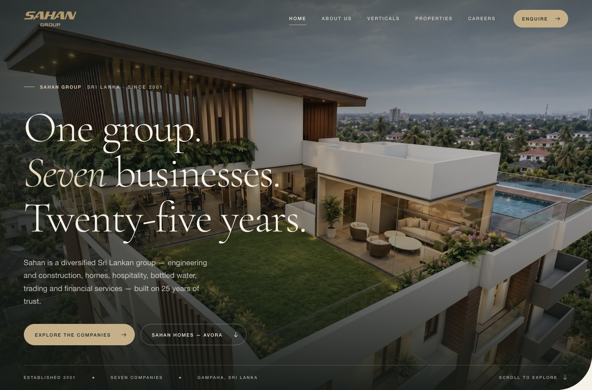

# Sahan Group — website



A static, five-page website for Sahan Group, built from the client's information request, company profile and brand documents, and aligned to the supplied Sahan Group Brand Guide — Midnight Canopy and Executive Pine greens, Golden Oak, Warm Cashmere and paper ivory — with the interaction language of [jxg.lk](https://jxg.lk/) and [unilever.com](https://www.unilever.com/).

Pages: **Home**, **About us**, **Verticals**, **Properties**, **Careers**.

---

## Open it

No build step is required. Everything is plain HTML, CSS and vanilla JavaScript.

- **Quickest:** double-click `index.html`.
- **Recommended (local server):**

  ```bash
  cd "Sahan Group "
  python3 -m http.server 8080
  ```

  Then visit <http://localhost:8080>.

Fonts are embedded in `assets/fonts/fonts.css`, so the site renders correctly even when opened directly from disk.

---

## The group

The site presents seven businesses. The first six are drawn from the client's files and logos; Kaze is retained from the October information request.

| Company | Sector | Summary |
| --- | --- | --- |
| **Sahan Engineering** | Engineering | Civil, building and water infrastructure; ICTAD registration C-9571, Grade C-4 building, with grades for highways, bridges, drainage, irrigation and marine works. |
| **Sahan Construction** | Real estate & construction | The group's main real estate and construction company — commercial, industrial and public projects, government tenders, warehouses, factories, homes and apartments. |
| **Sahan Homes** | Housing | A Sahan Construction company handling housing projects and apartments; developer of AVORA Residences. |
| **Kaze Restaurant & Pub** | Hospitality | Chinese and Sri Lankan dining, BYOB, three VIP rooms, two karaoke rooms, pub and banquet hall in Gampaha; 11 AM–11.30 PM; delivery via Uber Eats and PickMe. |
| **Pure Spring** | Bottled water | Natural mineral water from a 115-metre aquifer, bottled at source in Bandarawela on a fully automated line; 500 ml–19 L and a Premium range in development. |
| **Cassandara** | Trading | A Dubai-registered general trading company for imports and exports, with fresh produce — vegetables — at its core. |
| **Invest Lanka** | Financial services | Loans, gold loans and leasing for three-wheelers and motorcycles. |

---

## Structure

```
index.html                 Home — hero, who we are, seven companies, Journal, AVORA, commitments, social, principles, careers
about.html                 About us — story, chapters, group structure, values, quote
verticals.html             Verticals — a section per company, with sticky section navigation
properties.html            Properties — Sahan Homes and AVORA Residences, gallery, register-interest form
careers.html               Careers — culture, benefits, CV submission portal

assets/css/styles.css      Design system, layout, components, responsive rules
assets/js/main.js          Navigation, reveal-on-scroll, scrollspy, swimlanes, lightbox, forms
assets/fonts/fonts.css     Cormorant Garamond + Inter (latin subsets, embedded as data URIs)
assets/img/                Photography, AVORA renders, company logos, favicon, social image
assets/img/brand/          Pure Spring, Sahan Homes, Cassandara and Invest Lanka logos
_brand/                    Original supplied group logo files (PNG + SVG)
netlify.toml               Publish settings, security headers and CSP for Netlify
robots.txt / sitemap.xml   Crawl rules and page list (domain placeholder — see below)
404.html                   Branded not-found page
preview/                   Reference screenshots used in this README and for client review
```

---

## Brand system

| Token | Value | Use |
| --- | --- | --- |
| `--ink` | `#1c241e` | Graphite Pine — primary text and dark sections |
| `--forest` | `#283229` | Executive Pine — panels |
| `--forest-deep` | `#141915` | Midnight Canopy — footer and deepest surfaces |
| `--sage` / `--sage-deep` | `#6f7a6e` / `#3f4a42` | Meadow Mist / Highland Moss — secondary text and labels |
| `--gold` | `#c6b08a` | Golden Oak — brand gold on dark surfaces and buttons |
| `--gold-ink` | `#a8874f` | Accessible gold accent on paper |
| `--gold-label` | `#8e7344` | Small gold labels on paper |
| `--sand` / `--cream` | `#e7d9bf` / `#efe4ce` | Warm Cashmere accents and gradients |
| `--hearthstone` | `#a79a84` | Secondary neutral |
| `--paper` | `#f6f2e9` | Warm ivory page background |

Type: **Helvetica Neue** for body, navigation and UI (with **Inter** as the self-hosted fallback), **Cormorant Garamond** for editorial display, and **Optima** for property accents. Company logos are supplied artwork and set on neutral plates so their original backgrounds stay intact.

---

## Key content and interactions

- **Home** leads with the group proposition ("One group. Seven businesses. Twenty-five years."), then a seven-company grid, a Journal swimlane, AVORA (Sahan Homes), the group's four commitments, an On social strip, the group's principles and a careers call to action.
- **About** tells the 2001 origin story, the chapters that followed, the group structure (with Sahan Homes shown under Sahan Construction), the three values — respect, transparency, collaboration — and the group facts.
- **Verticals** gives each company a full section with services, facts, imagery and a contact route. The sticky sub-navigation tracks the section in view.
- **Properties** is the Sahan Homes / AVORA page: 24 apartments, 10 floors, 2/3/4 bedrooms, from LKR 24 million, construction 2027–2029, amenities, gallery lightbox, location and an enquiry form.
- **Careers** is a CV portal, not a job board: name, contact, LinkedIn, area of interest, note and CV type/size validation, with a two-day reply promise. The form opens the visitor's email app with the details filled in.

Shared interactions: sticky header with logo swap, full-screen mobile navigation, reveal-on-scroll, scroll progress, swimlane carousels with arrows/dots/keyboard support, accessible lightbox, and a sticky section subnav on Verticals.

---

## Unilever-inspired UI notes

The client asked for the feel of [unilever.com](https://www.unilever.com/). These patterns were adapted, not copied, and kept inside the Sahan brand palette and type system:

| Unilever pattern | Sahan implementation |
| --- | --- |
| Large rounded section ends and card masks | `--radius-section`, `--radius-mask`, `.section--round`; the next section shows through each bottom-right curve |
| Tag pills flush to the media edge | `.tag` on Journal and company cards, gold with ink text |
| News card grid and swimlane | `.swimlane` + `.ncard`: 3-up desktop, 2-up tablet, 82% peek on phones, arrows and dots |
| Four-pillar sustainability block | Commitments section with `.pillars` and four masked images |
| "On social media" strip with modal | Social swimlane; each tile opens the lightbox with its caption |
| Underlined card titles that clear on hover | `.ncard__title span` underline animation |
| Pill buttons with a moving arrow | `.btn` uses a full pill radius; the arrow slides on hover |

---

## Content and assets to review before going live

1. **Contact details** — `info@sahangroup.lk`, `careers@sahangroup.lk`, `077 239 9049`, `+94 33 223 3004`, 136/4 Minuwangoda, Miriswatta Road, Gampaha and 8.00 AM–4.00 PM come from the information request, the engineering profile and the brand guide. Confirm the main and WhatsApp lines, and whether the two email addresses exist yet.
2. **Social links** — footer and mobile-menu `href="#"` placeholders for Instagram, LinkedIn and Facebook. The `@sahangroup` handle is also a placeholder.
3. **Kaze** — retained from the October information request. The newest brief lists Engineering, Construction, Homes, Cassandara, Invest Lanka and Pure Spring but not Kaze; remove the Kaze section and grid card if it is no longer part of the group. Confirm Kaze's phone, reservation link and social accounts.
4. **Cassandara and Invest Lanka** — descriptions are based on the client's brief ("Dubai-registered", "imports and exports, vegetables", "loans, gold loans, leasing for three-wheelers and bikes"). Confirm the registered name, trade lanes, product range and the exact lending products, rates and regulatory wording before launch.
5. **Pure Spring** — product facts, aquifer depth, Bandarawela factory, ISO 22000/SLS/HACCP/GMP, and the order line `076 441 3391` come from the brief, the information request and the supplied campaign artwork. Confirm the certification numbers and the Premium range launch timing. The campaign images carry their own phone number and marketing copy.
6. **Sahan Engineering and Sahan Construction** — the engineering profile is for *Sahan Engineering and Construction (Pvt) Ltd* (ICTAD C-9571, Grade C-4). The site presents Engineering and Construction as two group businesses per the client's brief; confirm the legal entity structure and which projects may be named publicly.
7. **AVORA** — 24 apartments, 10 floors, 2/3/4 bedrooms, from LKR 24 million, 2027–2029, amenities and the Gampaha location come from the information request. Confirm pricing, payment plans, floor plans, brochure, sales contact and the Google Maps link. Renders are cropped and graded from the supplied `EXTERIOR.pdf`.
8. **Journal, commitments and social copy** — the six Journal entries, four commitments and five social captions are sample content written to demonstrate the layout. Replace them with approved stories and dates, and confirm the sustainability claims with the client.
9. **Photography** — AVORA visuals are the client's renders. Construction, trading, finance, hospitality, water and community photographs are royalty-free Unsplash images or client-supplied campaign artwork, used as placeholders; swap them for owned photography where possible.
10. **Forms** — both forms are backend-free and compose an email. Connect them to Netlify Forms or an ATS/form service for in-page submissions. The privacy notes are short starting points for Sri Lanka PDPA review.
11. **SEO and sharing** — `og:image` is relative; set an absolute URL on the final domain. Add `sitemap.xml`, `robots.txt`, canonical tags, a 404 page and security headers (see the launch plan).
12. **Deployment hygiene** — publish the site files only; keep `_brand/`, `preview/` and `README.md` out of the public web root.

Source documents used: *Sahan Group Website Information Request* (Gayan, 22 Oct 2026), *Sahan Engineering company profile 2025 part 01*, the three *Brand Manifesto & Discovery Brief* documents, *Sahan Group Brand Guide*, and the *4-day launch plan* (16 Nov 2026).

---

## Deploying

Upload the folder contents to any static host (Netlify, Vercel, Cloudflare Pages, S3, cPanel). No server-side runtime is needed. Keep `index.html` at the web root.

`netlify.toml` is ready for Netlify: it publishes the folder root, sets HSTS, `nosniff`, `X-Frame-Options`, `Referrer-Policy`, `Permissions-Policy` and a Content-Security-Policy whose script hash matches the inline `js` class script. Long-lived caching is set for `/assets/*`. The www-to-non-www redirect is present but commented out until the domain is confirmed — enable one direction only.

`robots.txt` and `sitemap.xml` currently use `https://sahangroup.lk/` as the domain. Replace it with the final domain before submitting the sitemap to Google Search Console. `404.html` is picked up automatically by Netlify.

For in-page form submissions, connect the two forms to Netlify Forms (or an ATS/form service) and add the honeypot and file-size limits described in the launch plan.
